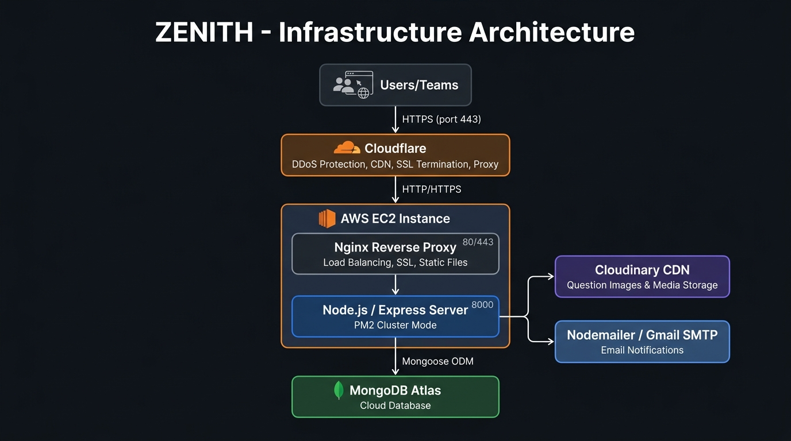
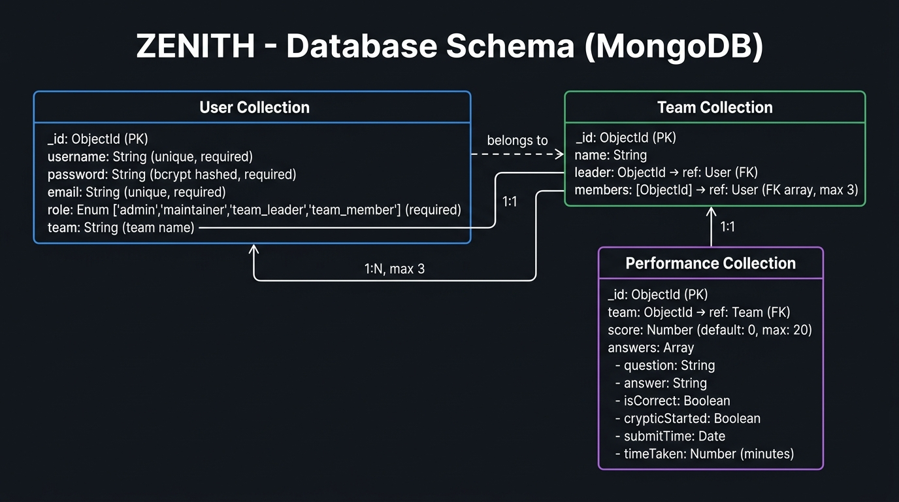
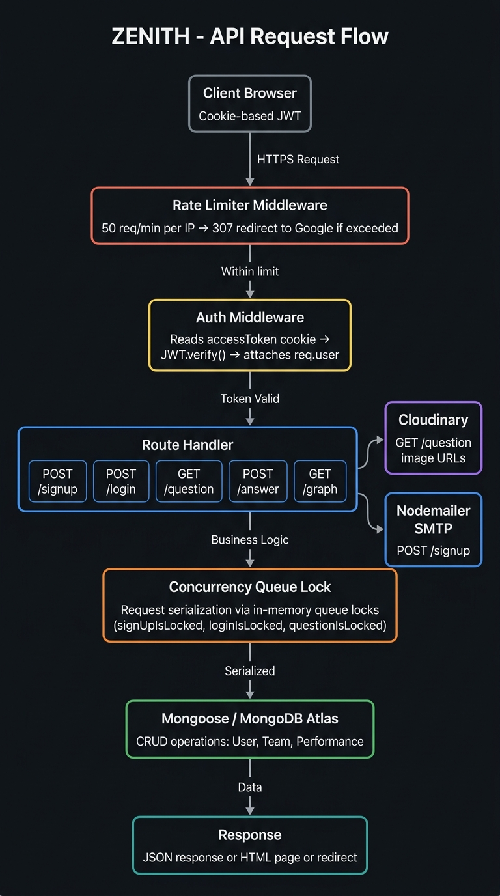

<div align="center">

# ? ZENITH
### *A Cryptic Hunt Web Platform by Backslash Computing Society, TIET*

[](https://nodejs.org)
[](https://expressjs.com)
[](https://mongodb.com)
[](https://aws.amazon.com/ec2/)
[](https://cloudflare.com)
[](https://cloudinary.com)

</div>

---

## ?? Overview

**Zenith** is a full-stack web platform built for hosting a live **Cryptic Hunt** event organized by the *Backslash Computing Society* at Thapar Institute of Engineering and Technology (TIET). It features team-based registration, JWT-authenticated sessions, a 20-question progressive cryptic puzzle engine with image and audio clues, a real-time leaderboard, and email notifications — all deployed on AWS EC2 with Cloudflare as the edge proxy.

---

## ??? Infrastructure Architecture

> The platform is deployed on **AWS EC2** behind **Cloudflare** (acting as DDoS protection + CDN proxy), with **Nginx** as the reverse proxy on the EC2 instance forwarding to the Node.js backend running under PM2. All question images and media are served from **Cloudinary**.



| Layer | Technology | Role |
|---|---|---|
| Edge | Cloudflare | DDoS protection, SSL termination, CDN caching, proxy |
| Server | AWS EC2 | Virtual machine hosting the entire application |
| Reverse Proxy | Nginx | Port 80/443 ? Port 8000, static file serving, SSL |
| Runtime | Node.js + PM2 | Application server in cluster mode |
| Media CDN | Cloudinary | Hosts all cryptic question images and GIFs |
| Email | Nodemailer (Gmail SMTP) | Sends welcome emails on registration |

---

## ??? Database Schema

> All data is stored on **MongoDB Atlas** (cloud) via Mongoose ODM. Three collections model the domain: `Users`, `Teams`, and `Performance`.



### Collections

#### ?? User
```js
{
  username : String  // unique, required (min 7, max 20 chars)
  password : String  // bcrypt hashed (10 salt rounds)
  email    : String  // unique, required
  role     : Enum    // 'admin' | 'maintainer' | 'team_leader' | 'team_member'
  team     : String  // team name the user belongs to
}
```

#### ?? Team
```js
{
  name    : String     // unique team name
  leader  : ObjectId   // ref ? User (team_leader)
  members : [ObjectId] // ref ? User (team_members, max 3)
}
```

#### ?? Performance
```js
{
  team  : ObjectId  // ref ? Team
  score : Number    // current question index (0-20, default 0)
  answers : [{
    question       : String
    answer         : String
    isCorrect      : Boolean
    crypticStarted : Boolean
    submitTime     : Date
    timeTaken      : Number  // minutes taken to answer
  }]
}
```

---

## ?? API Request Flow

> Every request passes through a rate limiter, then auth middleware, before hitting the business logic layer which uses in-memory queue locks to serialize concurrent writes to MongoDB.



---

## ??? API Endpoints

### Auth
| Method | Endpoint | Auth | Description |
|--------|----------|------|-------------|
| `POST` | `/signup` | ? | Register a new team + leader. Creates User, Team, Performance docs. Sends welcome email. |
| `POST` | `/login` | ? | Validate credentials. Returns `accessToken` + `refreshToken` as HttpOnly cookies. |
| `POST` | `/register` | ? team_leader | Register a new team member under the leader's team (max 3 members). |
| `POST` | `/refresh` | ? | Rotate access token using refresh token. |
| `POST` | `/logout` | ? | Clears `accessToken` and `refreshToken` cookies. |

### Cryptic Hunt
| Method | Endpoint | Auth | Description |
|--------|----------|------|-------------|
| `GET` | `/question` | ? | Fetch the current question (image URL, text clue, audio) based on team score. |
| `POST` | `/answer` | ? | Submit an answer. Validates case-insensitively, increments score, records time taken. |
| `POST` | `/reset` | ? | Admin reset of all team progress. |

### Leaderboard / Utils
| Method | Endpoint | Auth | Description |
|--------|----------|------|-------------|
| `GET` | `/graph` | ? | Returns all team performance as `{teamName, data: [{time, score}]}` for chart rendering. |
| `GET` | `/username` | ? | Returns the logged-in user's username from JWT. |

### Pages (SSR HTML)
| Route | Auth | Description |
|-------|------|-------------|
| `GET /` | ? | Redirects to `/login` |
| `GET /login` | ? | Login page (redirects to home if already authenticated) |
| `GET /signup` | ? | Sign-up page |
| `GET /home` | ? | Home page (different view for `team_leader` vs `team_member`) |
| `GET /crypt` | ? | Cryptic Hunt game page |
| `GET /leaderBoard` | ? | Public leaderboard page |
| `GET /members` | ? | Team members page |
| `GET /contact` | ? | Contact page |
| `GET /register` | ? team_leader | Member registration page |

---

## ?? Project Structure

```
zenith/
+-- package.json              # Root dependencies (ES modules)
+-- public/                   # Static frontend (served by Express/Nginx)
¦   +-- views/                # HTML pages (login, home, cryptic, leaderboard...)
¦   +-- scripts/              # Client-side JS (cryptic.js, home.js, card.js...)
¦   +-- assets/               # Images, logos, sponsor assets
¦   +-- *.css                 # Page-specific stylesheets
+-- Server/
    +-- app.js                # Express app entrypoint, routes wiring, PM2 cluster
    +-- src/
        +-- db/
        ¦   +-- mongoose.js           # MongoDB Atlas connection
        +-- models/
        ¦   +-- user.model.js         # User Mongoose model
        ¦   +-- team.model.js         # Team Mongoose model
        ¦   +-- Performance.model.js  # Performance Mongoose model
        +-- schemas/
        ¦   +-- user.schema.js        # Zod validation: login, signup, member
        ¦   +-- team.schema.js        # Zod validation: team
        ¦   +-- Performance.schema.js # Zod validation: performance
        ¦   +-- Cryptic.schema.js     # Zod validation: answer input (min 3, max 50)
        +-- routes/
        ¦   +-- authRoutes.js         # /signup /login /register /refresh
        ¦   +-- crypticRoute.js       # /question /answer /reset + LinkedList engine
        ¦   +-- leaderBoardRoute.js   # /graph
        ¦   +-- nameRoute.js          # /username
        ¦   +-- logoutroute.js        # /logout
        +-- middleware/
        ¦   +-- authMiddleware.js         # JWT verify, generateJwtToken, generateRefreshToken
        ¦   +-- rateLimiterMiddleware.js  # 50 req/min, 307 redirect to Google on breach
        +-- utils/
            +-- email.js    # Nodemailer welcome email via Gmail SMTP
            +-- jwtUtils.js # JWT sign / verify helpers
```

---

## ?? Key Technical Decisions

### ?? Authentication
- **JWT (jsonwebtoken)** stored as **HttpOnly, SameSite=Strict cookies** — no localStorage, XSS-safe.
- Access token: **15-hour expiry**. Refresh token: **7-day expiry**.
- The payload carries `{ _id: username, team: teamName, role }` for RBAC.

### ?? Security
- **Helmet** middleware (`noSniff`, `referrerPolicy: no-referrer`) for HTTP security headers.
- **Rate limiting**: 50 requests/min per IP via `express-rate-limit`. Violations are silently `307`-redirected to google.com.
- **Bcrypt** (10 salt rounds) for password hashing.
- **Zod** for server-side input validation on all auth endpoints.
- `trust proxy: 20` configured for correct IP detection behind Cloudflare + Nginx.

### ?? Cryptic Question Engine
- 20 questions stored as a **singly-linked list** (`QuestionNode`) in memory with `question`, `correctAnswer`, `imgUrl`, and `audio` fields.
- Team progress is tracked via the `score` field in `Performance` (acts as an array index into `questionArr`).
- Answer matching is **case-insensitive** (`toLowerCase()` comparison).
- Each correct answer records `submitTime` and `timeTaken` (in minutes) for leaderboard scoring.
- Question images are hosted on **Cloudinary** (`res.cloudinary.com/dnciaoigz/...`).

### ?? Concurrency Control
- Signup, login, register, and question fetching each use **in-memory queue lock** patterns (`isLocked` flag + request queue array) to serialize concurrent database writes and prevent race conditions during the live event.

### ?? Leaderboard
- The `/graph` endpoint aggregates all `Performance` documents, maps each to `{teamName, data: [{time, score}]}`, and returns it for client-side chart rendering.

---

## ?? Getting Started (Local Dev)

### Prerequisites
- Node.js 18+
- MongoDB Atlas URI
- Cloudinary account (for media)
- Gmail app password (for emails)

### Environment Variables
Create a `.env` file in the `Server/` directory:
```env
MONGODB_URI=mongodb+srv://<user>:<password>@cluster.mongodb.net/zenith
SECRET_KEY=your_jwt_secret_key
ENCRYPT_KEY=your_refresh_token_secret
EMAIL_PASSWORD=your_gmail_app_password
```

### Run Locally
```bash
# Install dependencies
npm install

# Start dev server (nodemon)
npm start
# Server runs on http://localhost:8000
```

---

## ??? Tech Stack

| Category | Technology |
|---|---|
| **Runtime** | Node.js (ES Modules) |
| **Framework** | Express.js 4.18 |
| **Database** | MongoDB Atlas + Mongoose 8 |
| **Auth** | JWT (jsonwebtoken) + bcrypt |
| **Validation** | Zod |
| **Email** | Nodemailer (Gmail SMTP) |
| **Media** | Cloudinary (images, GIFs) |
| **Security** | Helmet, express-rate-limit, HttpOnly cookies |
| **Process Mgr** | PM2 (cluster mode) |
| **Reverse Proxy** | Nginx |
| **Cloud** | AWS EC2 |
| **Edge/CDN** | Cloudflare |
| **Frontend** | Vanilla HTML, CSS, JavaScript |

---

## ?? About

**Zenith** was developed and maintained by the **Backslash Computing Society**, Thapar Institute of Engineering and Technology.

> *"Prepare yourself to embark on an adventure into a world of Virtual Riot and Warfare."*
> — Welcome email sent to every registered team

---

<div align="center">

Made with ? by **Backslash Computing Society, TIET**

</div>
